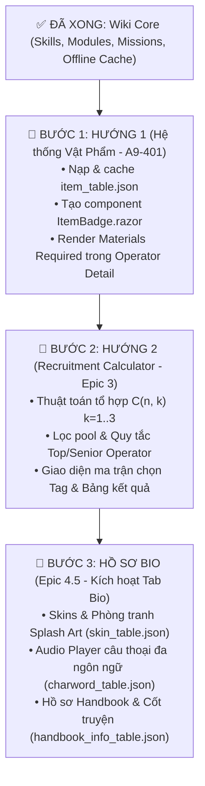

# 📑 Kế Hoạch Triển Khai Chi Tiết: Hướng 1 (Nguyên Liệu) ➡️ Hướng 2 (Recruitment) ➡️ Bio Hub

> [!IMPORTANT]
> Bản kế hoạch này hướng dẫn chi tiết từng bước thực hiện:
> 1. **Bước 1: Làm trước Hướng 1 (Hệ thống Vật phẩm & Nguyên liệu `item_table.json`)** để mở khóa toàn bộ bảng Materials trên trang Operator Detail và tạo nền tảng Planner.
> 2. **Bước 2: Làm tiếp Hướng 2 (Bộ tính Tag Tuyển chọn - Recruitment Calculator)** với thuật toán tổ hợp chuẩn cộng đồng (Aceship/Gamepress/PRTS).
> 3. **Bước 3: Triển khai Tab Bio (Skins, Voice Lines, Handbook)** ngay sau khi hoàn thành 2 hướng trên.

---

## 🗺️ Tổng Quan Kiến Trúc & Thứ Tự Thực Hiện



---

# 🌟 PHẦN 1: HƯỚNG DẪN CHI TIẾT HƯỚNG 1 — HỆ THỐNG VẬT PHẨM & NGUYÊN LIỆU (A9-401)

### 1.1. Mục Tiêu Kỹ Thuật
1. Nạp và lưu trữ bảng `item_table.json` chứa danh mục vật phẩm (nguyên liệu đá, gel, thiết bị, LMD, chip thăng cấp...).
2. Tạo component hiển thị vật phẩm chuẩn phong cách Arknights: `<ItemBadge.razor />` có viền màu theo độ hiếm (Tier 1 trắng, Tier 2 xanh lục, Tier 3 xanh lam, Tier 4 tím, Tier 5 cam/vàng), số lượng đính kèm và tooltip xem tên.
3. Mở khóa khối `<!-- Materials Table -->` đang bị ẩn tại [OperatorDetail.razor:974](file:///d:/VS_Studio/A9Tools/A9Tool/A9Tool/Components/Pages/OperatorDetail.razor#L974) để hiển thị chi phí nâng cấp Module (Stage 1, 2, 3).

---

### 1.2. Cấu Trúc Dữ Liệu `ItemData` (Core Layer)
Tạo file mới: `Core/Models/Entities/ItemData.cs`

```csharp
using System.Text.Json.Serialization;

namespace Core.Models.Entities
{
    public class ItemData
    {
        [JsonPropertyName("itemId")]
        public string? ItemId { get; set; }

        [JsonPropertyName("name")]
        public string? Name { get; set; }

        [JsonPropertyName("description")]
        public string? Description { get; set; }

        [JsonPropertyName("rarity")]
        public object? RawRarity { get; set; } // Game trả về "TIER_1".."TIER_5" hoặc số nguyên 0..4

        [JsonPropertyName("iconId")]
        public string? IconId { get; set; }

        [JsonPropertyName("sortId")]
        public int SortId { get; set; }

        [JsonPropertyName("classifyType")]
        public string? ClassifyType { get; set; }

        /// <summary>
        /// Trả về bậc độ hiếm chuẩn từ 1 đến 5 (1: Thường ... 5: Cực hiếm).
        /// </summary>
        [JsonIgnore]
        public int RarityTier
        {
            get
            {
                if (RawRarity == null) return 1;
                var str = RawRarity.ToString();
                if (int.TryParse(str, out var num)) return num + 1;
                return str switch
                {
                    "TIER_1" => 1,
                    "TIER_2" => 2,
                    "TIER_3" => 3,
                    "TIER_4" => 4,
                    "TIER_5" => 5,
                    _ => 1
                };
            }
        }
    }

    public class ItemTableResponse
    {
        [JsonPropertyName("items")]
        public Dictionary<string, ItemData> Items { get; set; } = new();
    }
}
```

---

### 1.3. Bổ Sung Repository & Cache (Infrastructure Layer) - [ĐÃ HOÀN THÀNH ✅]
* **Schema FlatBuffers:** `Infrastructure/FlatBuffers/Schemas/item_table.fbs`
  * Tải từ nguồn chuẩn `MooncellWiki/OpenArknightsFBS` và tự động copy vào thư mục build.
* **File:** `Core/Interfaces/IGameDataRepository.cs`
  ```csharp
  Task<Dictionary<string, ItemData>?> GetItemTableAsync();
  ```
* **File:** `Infrastructure/Github/GithubGameDataRepository .cs`
  * Sử dụng cơ chế đồng bộ `LoadTableAsync<ItemData>(localpath, "item_table", "item_table.fbs")`.
  * Luồng nạp:
    1. Kiểm tra cache đĩa `item_table.json` (hợp lệ trong 24 giờ).
    2. Nếu miss/lỗi, tìm và tải file nhị phân `item_table*.bytes` mới nhất từ `ArknightsAssets2`.
    3. Dùng `flatc.exe` và `item_table.fbs` giải mã sang JSON và lưu cache đĩa.
    4. Cập nhật `ResetCache()` tự động làm mới `item_table.json`.
* **File:** `Core/Services/CharacterService.cs`
  * Bổ sung helper `GetItemTableAsync()` và `GetItemByIdAsync(string? itemId)`.

---

### 1.4. Thiết Kế Component `ItemBadge.razor` (Presentation Layer)
Tạo file mới: `A9Tool/Components/Common/ItemBadge.razor`

```razor
@using Core.Models.Entities
@inject Core.Services.CharacterService CharacterService

<div class="a9-item-badge tier-@Tier" title="@DisplayName">
    <div class="a9-item-icon-box">
        
        <span class="a9-item-tier-bar"></span>
    </div>
    @if (Count > 0)
    {
        <div class="a9-item-count">@FormatCount(Count)</div>
    }
</div>

@code {
    [Parameter] public string? ItemId { get; set; }
    [Parameter] public int Count { get; set; }
    [Parameter] public string? CustomName { get; set; }

    private ItemData? itemInfo;

    protected override async Task OnParametersSetAsync()
    {
        if (!string.IsNullOrEmpty(ItemId))
        {
            itemInfo = await CharacterService.GetItemAsync(ItemId);
        }
    }

    private int Tier => itemInfo?.RarityTier ?? 1;
    private string DisplayName => CustomName ?? itemInfo?.Name ?? ItemId ?? "Item";
    private string IconUrl => !string.IsNullOrEmpty(itemInfo?.IconId)
        ? $"https://raw.githubusercontent.com/ArknightsAssets/ArknightsAssets2/en/assets/dyn/arts/items/icons/{itemInfo.IconId}.png"
        : (!string.IsNullOrEmpty(ItemId) ? $"https://raw.githubusercontent.com/ArknightsAssets/ArknightsAssets2/en/assets/dyn/arts/items/icons/{ItemId}.png" : "/assets/icons/characterdetail/sprite_profession.png");

    private string FormatCount(int c) => c >= 10000 ? $"{c / 1000}k" : c.ToString();
}
```

---

### 1.5. Mở Khóa Giao Diện Trong `OperatorDetail.razor`
Tại dòng 974, gỡ comment và render bảng nguyên liệu cho Module:

```razor
<!-- Materials Box (Module Stage 1, 2, 3) -->
@if (CurrentModule != null && CurrentModule.ItemCost != null && CurrentModule.ItemCost.Count > 0)
{
    <div class="od-mod-materials-box">
        <div class="od-mod-box-header">Materials Required</div>
        <div class="od-mod-mat-stages">
            @for (int stage = 1; stage <= CurrentModule.ItemCost.Count; stage++)
            {
                var stageCosts = GetModuleStageCosts(CurrentModule, stage);
                <div class="od-mod-stage-cost-row">
                    <span class="od-mod-stage-tag">STAGE @stage</span>
                    <div class="od-mod-stage-items">
                        @foreach (var bundle in stageCosts)
                        {
                            <ItemBadge ItemId="@bundle.Id" Count="@bundle.Count" />
                        }
                    </div>
                </div>
            }
        </div>
    </div>
}
```

---

### 1.6. Chi Tiết CSS Cho ItemBadge & Materials Table (Đã Nối Vào `app.css`)
```css
/* Item Badge Base */
.a9-item-badge {
    position: relative;
    display: inline-flex;
    flex-direction: column;
    align-items: center;
    width: 58px;
    background: rgba(15, 23, 42, 0.75);
    border: 1px solid rgba(255, 255, 255, 0.1);
    border-radius: 8px;
    padding: 4px;
    box-shadow: 0 4px 12px rgba(0, 0, 0, 0.35);
    transition: transform 0.2s ease, border-color 0.2s ease, box-shadow 0.2s ease;
    user-select: none;
}
.a9-item-badge:hover { transform: translateY(-2px); }

.a9-item-icon-box {
    position: relative;
    width: 48px;
    height: 48px;
    display: flex;
    align-items: center;
    justify-content: center;
    border-radius: 6px;
    background: radial-gradient(circle, rgba(255, 255, 255, 0.05) 0%, rgba(0, 0, 0, 0.3) 100%);
    overflow: hidden;
}
.a9-item-img {
    width: 44px;
    height: 44px;
    object-fit: contain;
    filter: drop-shadow(0 2px 4px rgba(0, 0, 0, 0.6));
}
.a9-item-tier-bar {
    position: absolute;
    bottom: 0; left: 0; right: 0;
    height: 3px;
    border-radius: 0 0 6px 6px;
}
.a9-item-count {
    position: absolute;
    bottom: -6px; right: -4px;
    background: #0f172a;
    border: 1px solid rgba(255, 255, 255, 0.2);
    color: #f8fafc;
    font-size: 0.65rem;
    font-weight: 800;
    padding: 0 5px;
    border-radius: 10px;
    line-height: 14px;
    box-shadow: 0 2px 4px rgba(0, 0, 0, 0.5);
}

/* Tier Colors: 1 White, 2 Green, 3 Blue, 4 Purple, 5 Gold */
.a9-item-badge.tier-1 { border-color: rgba(148, 163, 184, 0.25); }
.a9-item-badge.tier-1 .a9-item-tier-bar { background: #94a3b8; }

.a9-item-badge.tier-2 { border-color: rgba(74, 222, 128, 0.3); }
.a9-item-badge.tier-2 .a9-item-tier-bar { background: #4ade80; box-shadow: 0 0 6px rgba(74, 222, 128, 0.6); }

.a9-item-badge.tier-3 { border-color: rgba(56, 189, 248, 0.35); }
.a9-item-badge.tier-3 .a9-item-tier-bar { background: #38bdf8; box-shadow: 0 0 6px rgba(56, 189, 248, 0.6); }

.a9-item-badge.tier-4 { border-color: rgba(192, 132, 252, 0.4); }
.a9-item-badge.tier-4 .a9-item-tier-bar { background: #c084fc; box-shadow: 0 0 8px rgba(192, 132, 252, 0.7); }

.a9-item-badge.tier-5 {
    border-color: rgba(251, 191, 36, 0.5);
    background: linear-gradient(180deg, rgba(30, 27, 75, 0.8) 0%, rgba(15, 23, 42, 0.9) 100%);
}
.a9-item-badge.tier-5 .a9-item-tier-bar {
    background: linear-gradient(90deg, #f59e0b, #fbbf24);
    box-shadow: 0 0 10px rgba(251, 191, 36, 0.8);
}

/* Materials Container in Operator Detail */
.od-mod-materials-box {
    margin-top: 14px;
    background: rgba(15, 23, 42, 0.65);
    border: 1px solid rgba(255, 255, 255, 0.08);
    border-radius: 8px;
    overflow: hidden;
}
.od-mod-mat-stages { padding: 12px; display: flex; flex-direction: column; gap: 12px; }
.od-mod-stage-cost-row {
    display: flex; align-items: center; gap: 14px;
    padding: 8px 12px;
    background: rgba(30, 41, 59, 0.45);
    border-radius: 6px;
    border: 1px solid rgba(255, 255, 255, 0.04);
}
.od-mod-stage-tag {
    font-size: 0.72rem; font-weight: 800; letter-spacing: 0.06em;
    color: #38bdf8;
    background: rgba(56, 189, 248, 0.12);
    border: 1px solid rgba(56, 189, 248, 0.25);
    border-radius: 4px; padding: 3px 8px;
}
.od-mod-stage-items { display: flex; align-items: center; flex-wrap: wrap; gap: 10px; }
```


---

# 🎯 PHẦN 2: HƯỚNG DẪN TỰ CODE TỪNG BƯỚC — BỘ TÍNH TAG TUYỂN CHỌN (RECRUITMENT CALCULATOR)

> [!TIP]
> **Mục tiêu của bộ tính (Recruitment Calculator):**
> Trong Arknights, người chơi quay tuyển chọn (Recruitment) sẽ nhận được 5 Tags ngẫu nhiên. Người chơi có thể chọn tối đa **3 Tags**.
> Nhiệm vụ của công cụ: **Tìm ra tất cả các tổ hợp (từ 1 đến 3 tags) đảm bảo (guaranteed) ra Operator 4★, 5★ hoặc 6★** để người chơi không bao giờ bỏ lỡ Operator hiếm!

---

### ❓ Trả Lời: Làm Cái Này Xong, Sau Này Làm Filter Theo Tag Có Tiện Không?

**TRẢ LỜI: CỰC KỲ TIỆN VÀ TÁI SỬ DỤNG ĐƯỢC 100%!**

Lý do:
1. **Chuẩn Hóa Tag Tập Trung:** Trong game, thông tin của Operator bị phân mảnh:
   - Các tag đặc điểm nằm ở `op.Tags` (danh sách: `Healing`, `DPS`, `Survival`...).
   - Vị trí đánh nằm ở `op.Position` (giá trị: `"MELEE"`, `"RANGED"`).
   - Chức nghiệp nằm ở `op.Profession` (giá trị thô: `"WARRIOR"`, `"TANK"`, `"PIONEER"`...).
   - Cấp độ nằm ở `op.Rarity` (ví dụ `TIER_6` tương ứng với tag `"Top Operator"`, `TIER_5` tương ứng với `"Senior Operator"`).
2. **Khi bạn viết hàm `GetOperatorAllTags(Character op)`**: Toàn bộ các thông tin trên được gom lại thành 1 `HashSet<string>` duy nhất chứa đầy đủ các tag chuẩn hóa tiếng Anh (`"Melee"`, `"Guard"`, `"DPS"`, `"Top Operator"`...).
3. **Khi làm Filter cho trang Operators Catalog (`/operators`) sau này:**
   - Bạn chỉ cần dùng lại đúng hàm này!
   - Điều kiện lọc đơn giản chỉ là:
     ```csharp
     var matched = allOps.Where(op => selectedTags.All(t => GetOperatorAllTags(op).Contains(t)));
     ```
   - Do đó, viết xong logic cho Recruitment xem như bạn đã hoàn thành **80% logic bộ lọc Tag** cho trang Operators!

---

## 📋 Checklist 5 Bước Triển Khai (Tự Code Theo Sườn)

- [ ] **Bước 1:** Viết Service `Core/Services/RecruitmentService.cs` theo danh sách hàm bên dưới.
- [ ] **Bước 2:** Đăng ký Service vào DI trong `A9Tool/MauiProgram.cs`.
- [ ] **Bước 3:** Ghép giao diện `A9Tool/Components/Pages/Recruitment.razor` theo sườn HTML Skeleton.
- [ ] **Bước 4:** Thêm mục điều hướng `/recruitment` vào Sidebar `A9Tool/Components/Layout/MainLayout.razor`.
- [ ] **Bước 5:** Thử nghiệm với các bộ tag test case thực tế trong game.

---

## 🛠️ BƯỚC 1: SƯỜN HÀM CHO `RecruitmentService.cs`

Tạo file mới tại: `Core/Services/RecruitmentService.cs`

### 🔹 1. Cấu trúc dữ liệu kết quả: `RecruitmentCombinationResult`
Các thuộc tính bạn cần định nghĩa trong class này:
- `List<string> Tags`: Danh sách các tag của tổ hợp này (ví dụ `["Guard", "Survival"]`).
- `List<Character> MatchedOperators`: Danh sách các Operator thỏa mãn tổ hợp tag.
- `int MinRarity`: Độ hiếm nhỏ nhất trong số các Operator trúng khớp (1 đến 6).
- `int MaxRarity`: Độ hiếm lớn nhất trong số các Operator trúng khớp (1 đến 6).
- `bool IsGuaranteed4Plus => MinRarity >= 4;`: Cờ đánh dấu nếu tổ hợp chắc chắn ra từ 4★ trở lên (không có 3★ nào lọt vào).
- `bool Has5Star`, `bool Has6Star`: Cờ kiểm tra có chứa 5★ / 6★ hay không.
- Hàm helper `static int GetTier(string? r)`: Chuyển `"TIER_6"` thành số `6`, `"TIER_5"` thành `5`...

---

### 🔹 2. Danh Sách Các Hàm Cần Viết Trong `RecruitmentService`:

| Tên Hàm | Tham Số Đầu Vào | Kết Quả Trả Về | Nhiệm Vụ Cụ Thể Cần Làm |
| :--- | :--- | :--- | :--- |
| **`CalculateCombinationsAsync`** | `List<string> selectedTags` | `Task<List<RecruitmentCombinationResult>>` | **Hàm chính:** <br>1. Gọi `_characterService.GetAllAsync()` để lấy danh sách op.<br>2. Gọi `GenerateCombinations(selectedTags, maxK: 3)` để sinh các combo $k \in \{1, 2, 3\}$.<br>3. Duyệt từng combo: Lọc các op thỏa mãn combo (áp dụng luật 6★!).<br>4. Tạo `RecruitmentCombinationResult` và sắp xếp ưu tiên (6★ ➔ 4★+ ➔ MinRarity cao ➔ Combo ngắn hơn). |
| **`GenerateCombinations`** | `List<string> list`, `int maxK` | `List<List<string>>` | Vòng lặp từ $k = 1$ đến $k = \min(list.Count, maxK)$, gọi đệ quy `GenerateKCombinations`. |
| **`GenerateKCombinations`** | `list, start, k, current, result` | `void` (đệ quy) | Thuật toán quay lui (backtracking) sinh tổ hợp $C(n, k)$ kinh điển. Khi `current.Count == k`, clone và add vào `result`. |
| **`GetOperatorAllTags`** | `Character op` | `HashSet<string>` | Gom: `op.Tags` + `FormatPosition(op.Position)` + `FormatProfession(op.Profession)` + Tag cấp bậc (`Top Operator` nếu 6★, `Senior Operator` nếu 5★, `Starter` nếu 2★, `Robot` nếu 1★). |
| **`FormatPosition`** | `string p` | `string` | Đổi `"MELEE"` ➔ `"Melee"`, còn lại là `"Ranged"`. |
| **`FormatProfession`** | `string p` | `string` | Đổi code game thô: `"WARRIOR"` ➔ `"Guard"`, `"TANK"` ➔ `"Defender"`, `"PIONEER"` ➔ `"Vanguard"`... |
| **`FilterRecruitmentPool`** | `List<Character> allOps` | `List<Character>` | Lọc danh sách nhân vật có trong tuyển dụng (loại bỏ nhân vật rỗng). |

> [!WARNING]
> **Luật 6★ sống còn:** Trong `CalculateCombinationsAsync`, khi duyệt từng Operator:
> Nếu Operator là 6★ mà combo **KHÔNG CHỨA** `"Top Operator"`, **bắt buộc loại bỏ (`return false`)**!

---

<details>
<summary><b>👉 [BẤM VÀO ĐÂY ĐỂ XEM MÃ NGUỒN HOÀN CHỈNH: RecruitmentService.cs]</b> <i>(Chỉ mở khi bạn muốn đối chiếu hoặc bị kẹt)</i></summary>

```csharp
using Core.Models.Entities;
using System;
using System.Collections.Generic;
using System.Linq;
using System.Threading.Tasks;

namespace Core.Services
{
    public class RecruitmentCombinationResult
    {
        public List<string> Tags { get; set; } = [];
        public List<Character> MatchedOperators { get; set; } = [];
        public int MinRarity { get; set; }
        public int MaxRarity { get; set; }

        public bool IsGuaranteed4Plus => MinRarity >= 4;
        public bool Has5Star => MatchedOperators.Any(o => GetTier(o.Rarity) == 5);
        public bool Has6Star => MatchedOperators.Any(o => GetTier(o.Rarity) == 6);

        public static int GetTier(string? r) => r switch
        {
            "TIER_6" => 6,
            "TIER_5" => 5,
            "TIER_4" => 4,
            "TIER_3" => 3,
            "TIER_2" => 2,
            "TIER_1" => 1,
            _ => 1
        };
    }

    public class RecruitmentService
    {
        private readonly CharacterService _characterService;

        public RecruitmentService(CharacterService characterService)
        {
            _characterService = characterService;
        }

        public async Task<List<RecruitmentCombinationResult>> CalculateCombinationsAsync(List<string> selectedTags)
        {
            if (selectedTags == null || selectedTags.Count == 0) return [];

            var allOps = await _characterService.GetAllAsync();
            var recruitPool = FilterRecruitmentPool(allOps);

            var combos = GenerateCombinations(selectedTags, maxK: 3);
            var results = new List<RecruitmentCombinationResult>();

            foreach (var combo in combos)
            {
                bool hasTopOp = combo.Contains("Top Operator", StringComparer.OrdinalIgnoreCase);

                var matched = recruitPool.Where(op =>
                {
                    int tier = RecruitmentCombinationResult.GetTier(op.Rarity);

                    // Luật sống còn: 6★ chỉ ra khi có tag Top Operator
                    if (tier == 6 && !hasTopOp) return false;

                    var opTags = GetOperatorAllTags(op);
                    return combo.All(tag => opTags.Contains(tag, StringComparer.OrdinalIgnoreCase));
                }).ToList();

                if (matched.Count > 0)
                {
                    int minRarity = matched.Min(o => RecruitmentCombinationResult.GetTier(o.Rarity));
                    int maxRarity = matched.Max(o => RecruitmentCombinationResult.GetTier(o.Rarity));

                    results.Add(new RecruitmentCombinationResult
                    {
                        Tags = combo,
                        MatchedOperators = matched.OrderByDescending(o => RecruitmentCombinationResult.GetTier(o.Rarity)).ToList(),
                        MinRarity = minRarity,
                        MaxRarity = maxRarity
                    });
                }
            }

            return results
                .OrderByDescending(r => r.Has6Star)
                .ThenByDescending(r => r.IsGuaranteed4Plus)
                .ThenByDescending(r => r.MinRarity)
                .ThenByDescending(r => r.MaxRarity)
                .ThenBy(r => r.Tags.Count)
                .ToList();
        }

        private static List<List<string>> GenerateCombinations(List<string> list, int maxK)
        {
            var result = new List<List<string>>();
            int n = list.Count;
            int limit = Math.Min(n, maxK);

            for (int k = 1; k <= limit; k++)
            {
                GenerateKCombinations(list, 0, k, new List<string>(), result);
            }
            return result;
        }

        private static void GenerateKCombinations(List<string> list, int start, int k, List<string> current, List<List<string>> result)
        {
            if (current.Count == k)
            {
                result.Add(new List<string>(current));
                return;
            }
            for (int i = start; i < list.Count; i++)
            {
                current.Add(list[i]);
                GenerateKCombinations(list, i + 1, k, current, result);
                current.RemoveAt(current.Count - 1);
            }
        }

        public static HashSet<string> GetOperatorAllTags(Character op)
        {
            var tags = new HashSet<string>(op.Tags ?? [], StringComparer.OrdinalIgnoreCase);

            if (!string.IsNullOrEmpty(op.Position)) 
                tags.Add(FormatPosition(op.Position));

            if (!string.IsNullOrEmpty(op.Profession)) 
                tags.Add(FormatProfession(op.Profession));

            int tier = RecruitmentCombinationResult.GetTier(op.Rarity);
            if (tier == 6) tags.Add("Top Operator");
            if (tier == 5) tags.Add("Senior Operator");
            if (tier == 2) tags.Add("Starter");
            if (tier == 1) tags.Add("Robot");

            return tags;
        }

        private static string FormatPosition(string p) => 
            p.Equals("MELEE", StringComparison.OrdinalIgnoreCase) ? "Melee" : "Ranged";

        private static string FormatProfession(string p) => p switch
        {
            "PIONEER" => "Vanguard",
            "WARRIOR" => "Guard",
            "TANK" => "Defender",
            "SNIPER" => "Sniper",
            "CASTER" => "Caster",
            "MEDIC" => "Medic",
            "SUPPORT" => "Supporter",
            "SPECIAL" => "Specialist",
            _ => p
        };

        private static List<Character> FilterRecruitmentPool(List<Character> allOps)
        {
            return allOps.Where(o => !string.IsNullOrEmpty(o.Name)).ToList();
        }
    }
}
```
</details>

---

## 🛠️ BƯỚC 2: ĐĂNG KÝ DI TRONG `MauiProgram.cs`

Mở [A9Tool/MauiProgram.cs](file:///d:/VS_Studio/A9Tools/A9Tool/A9Tool/MauiProgram.cs):
```csharp
builder.Services.AddScoped<CharacterService>();
builder.Services.AddSingleton<LevelingCostService>();
builder.Services.AddScoped<RecruitmentService>(); // 👈 Thêm dòng này
```

---

## 🛠️ BƯỚC 3: SƯỜN KHUNG HTML & CODE CHO `Recruitment.razor`

Tạo file mới tại: `A9Tool/Components/Pages/Recruitment.razor`

### 🔹 Sườn Cây Thư Mục DOM (HTML Skeleton Tree):

```html
@page "/recruitment"
@inject RecruitmentService RecService
@inject NavigationManager Nav

<div class="rec-container">
    
    <!-- 1. HEADER BAR -->
    <div class="rec-header">
        <div class="rec-header-title">📋 Recruitment Calculator</div>
        <div class="rec-actions-bar">
            <span class="rec-selected-count">Selected: <b>@selectedTags.Count</b> / 5</span>
            <!-- Nút Clear All nếu có tag được chọn -->
            <button class="rec-btn-clear" @onclick="ClearAll">Clear All ✕</button>
        </div>
    </div>

    <!-- 2. MA TRẬN 28 TAGS (4 NHÓM) -->
    <div class="rec-matrix-panel">
        
        <!-- Nhóm 1: Qualification (Top, Senior, Starter, Robot) -->
        <div class="rec-tag-group">
            <span class="rec-group-title">Qualification</span>
            <div class="rec-tags-row">
                <!-- Vòng lặp foreach nút bấm tag -->
                <button class="rec-tag-btn @(isSelected ? "active" : "")" @onclick="() => ToggleTag(tag)">@tag</button>
            </div>
        </div>

        <!-- Nhóm 2: Position (Melee, Ranged) -->
        <div class="rec-tag-group">
            <span class="rec-group-title">Position</span>
            <div class="rec-tags-row">...</div>
        </div>

        <!-- Nhóm 3: Classes (8 nghề: Vanguard, Guard, Defender...) -->
        <div class="rec-tag-group">
            <span class="rec-group-title">Classes</span>
            <div class="rec-tags-row">...</div>
        </div>

        <!-- Nhóm 4: Afflictions (14 đặc điểm: Healing, DPS, Survival...) -->
        <div class="rec-tag-group">
            <span class="rec-group-title">Afflictions</span>
            <div class="rec-tags-row">...</div>
        </div>

    </div>

    <!-- 3. KHU VỰC KẾT QUẢ TỔ HỢP -->
    <div class="rec-results-panel">
        <!-- Nếu đang tính: Loading spinner/text -->
        <!-- Nếu chưa chọn tag: Thông báo nhắc nhở chọn tag -->
        <!-- Nếu có kết quả: Hiển thị danh sách card tổ hợp -->
        <div class="rec-results-grid">
            
            <!-- Mỗi tổ hợp là 1 Card .rec-combo-card (thêm class .tier-6, .tier-5, hoặc .guaranteed-4) -->
            <div class="rec-combo-card @cardTierClass">
                <div class="rec-combo-header">
                    <div class="rec-combo-tags">
                        <!-- Danh sách viên tag trong combo: <span class="rec-combo-tag-pill">Tag</span> -->
                    </div>
                    <div class="rec-combo-badge">
                        <!-- Badge chữ: TOP GUARANTEED (6★) / SENIOR GUARANTEED (5★) / 4★+ GUARANTEED -->
                    </div>
                </div>

                <div class="rec-matched-ops">
                    <!-- Danh sách các chip nhân vật: .rec-op-chip (.star-6, .star-5, .star-4...) -->
                    <div class="rec-op-chip star-@tier" @onclick="() => NavigateToOperator(op.Id)">
                        
                        <span class="rec-op-name">@op.Name</span>
                        <span class="rec-op-rarity">@tier★</span>
                    </div>
                </div>
            </div>

        </div>
    </div>

</div>
```

---

### 🔹 Các Biến & Hàm Cần Viết Trong Khối `@code`:

```csharp
@code {
    // 1. Quản lý trạng thái
    private List<string> selectedTags = [];
    private List<RecruitmentCombinationResult> combinations = [];
    private bool isLoading = false;

    // 2. Mảng 28 tag chuẩn Arknights
    private static readonly string[] QualificationTags = ["Top Operator", "Senior Operator", "Starter", "Robot"];
    private static readonly string[] PositionTags = ["Melee", "Ranged"];
    private static readonly string[] ClassTags = ["Vanguard", "Guard", "Defender", "Sniper", "Caster", "Medic", "Supporter", "Specialist"];
    private static readonly string[] AfflictionTags = [
        "Healing", "DPS", "Defense", "Survival", "AoE", "Slow", 
        "Crowd-Control", "Fast-Redeploy", "Shift", "Debuff", "Support", 
        "DP-Recovery", "Nuker", "Summon"
    ];

    // 3. Hàm bật/tắt chọn Tag (Tối đa 5 tag)
    private async Task ToggleTag(string tag) { ... }

    // 4. Hàm xóa sạch tag đã chọn
    private async Task ClearAll() { ... }

    // 5. Hàm gọi RecService tính toán lại khi tag thay đổi
    private async Task RecalculateAsync() { ... }

    // 6. Chuyển trang sang OperatorDetail
    private void NavigateToOperator(string? id) => Nav.NavigateTo($"/operators/{id}");

    // 7. Lấy URL Avatar từ ArknightsAssets CDN
    private static string GetAvatarUrl(string? id) =>
        $"https://raw.githubusercontent.com/ArknightsAssets/ArknightsAssets2/cn/assets/dyn/arts/characters/{id}/{id}_1.png";
}
```

---

<details>
<summary><b>👉 [BẤM VÀO ĐÂY ĐỂ XEM MÃ NGUỒN HOÀN CHỈNH: Recruitment.razor]</b> <i>(Chỉ mở khi bạn muốn copy nhanh hoặc đối chiếu)</i></summary>

```razor
@page "/recruitment"
@using Core.Models.Entities
@using Core.Services
@inject RecruitmentService RecService
@inject NavigationManager Nav

<div class="rec-container">
    <div class="rec-header">
        <div class="rec-header-title">
            <span>📋</span> Recruitment Calculator
        </div>
        <div class="rec-actions-bar">
            <span class="rec-selected-count">Selected: <b>@selectedTags.Count</b> / 5</span>
            @if (selectedTags.Count > 0)
            {
                <button class="rec-btn-clear" @onclick="ClearAll">Clear All ✕</button>
            }
        </div>
    </div>

    <div class="rec-matrix-panel">
        <div class="rec-tag-group">
            <span class="rec-group-title">Qualification</span>
            <div class="rec-tags-row">
                @foreach (var tag in QualificationTags)
                {
                    var isSelected = selectedTags.Contains(tag);
                    var extraClass = tag switch
                    {
                        "Top Operator" => "tag-top",
                        "Senior Operator" => "tag-senior",
                        "Robot" => "tag-robot",
                        _ => ""
                    };
                    <button class="rec-tag-btn @extraClass @(isSelected ? "active" : "")"
                            @onclick="() => ToggleTag(tag)">
                        @tag
                    </button>
                }
            </div>
        </div>

        <div class="rec-tag-group">
            <span class="rec-group-title">Position</span>
            <div class="rec-tags-row">
                @foreach (var tag in PositionTags)
                {
                    var isSelected = selectedTags.Contains(tag);
                    <button class="rec-tag-btn @(isSelected ? "active" : "")"
                            @onclick="() => ToggleTag(tag)">
                        @tag
                    </button>
                }
            </div>
        </div>

        <div class="rec-tag-group">
            <span class="rec-group-title">Classes</span>
            <div class="rec-tags-row">
                @foreach (var tag in ClassTags)
                {
                    var isSelected = selectedTags.Contains(tag);
                    <button class="rec-tag-btn @(isSelected ? "active" : "")"
                            @onclick="() => ToggleTag(tag)">
                        @tag
                    </button>
                }
            </div>
        </div>

        <div class="rec-tag-group">
            <span class="rec-group-title">Afflictions</span>
            <div class="rec-tags-row">
                @foreach (var tag in AfflictionTags)
                {
                    var isSelected = selectedTags.Contains(tag);
                    <button class="rec-tag-btn @(isSelected ? "active" : "")"
                            @onclick="() => ToggleTag(tag)">
                        @tag
                    </button>
                }
            </div>
        </div>
    </div>

    <div class="rec-results-panel">
        @if (isLoading)
        {
            <div style="text-align: center; color: #94a3b8; padding: 20px;">
                <span>Calculating combinations...</span>
            </div>
        }
        else if (selectedTags.Count == 0)
        {
            <div style="text-align: center; color: #64748b; padding: 30px;">
                <span>Select up to 5 tags above to calculate guaranteed recruitment combinations.</span>
            </div>
        }
        else if (combinations.Count == 0)
        {
            <div style="text-align: center; color: #f87171; padding: 30px;">
                <span>No operators match any combination of the selected tags.</span>
            </div>
        }
        else
        {
            <div class="rec-results-grid">
                @foreach (var combo in combinations)
                {
                    var cardTierClass = combo.Has6Star ? "tier-6" 
                        : (combo.MinRarity == 5 || combo.Tags.Contains("Senior Operator") ? "tier-5"
                        : (combo.IsGuaranteed4Plus ? "guaranteed-4" : ""));

                    <div class="rec-combo-card @cardTierClass">
                        <div class="rec-combo-header">
                            <div class="rec-combo-tags">
                                @foreach (var t in combo.Tags)
                                {
                                    <span class="rec-combo-tag-pill">@t</span>
                                }
                            </div>
                            <div class="rec-combo-badge">
                                @if (combo.Has6Star)
                                {
                                    <span>★ TOP GUARANTEED (6★)</span>
                                }
                                else if (combo.MinRarity == 5 || combo.Tags.Contains("Senior Operator"))
                                {
                                    <span>★ SENIOR GUARANTEED (5★)</span>
                                }
                                else if (combo.IsGuaranteed4Plus)
                                {
                                    <span>★ 4★+ GUARANTEED</span>
                                }
                                else
                                {
                                    <span style="opacity: 0.7;">POSSIBLE (3★~@(combo.MaxRarity)★)</span>
                                }
                            </div>
                        </div>

                        <div class="rec-matched-ops">
                            @foreach (var op in combo.MatchedOperators)
                            {
                                var tier = RecruitmentCombinationResult.GetTier(op.Rarity);
                                <div class="rec-op-chip star-@tier" @onclick="() => NavigateToOperator(op.Id)" title="@op.Name (@tier★)">
                                    
                                    <span class="rec-op-name">@op.Name</span>
                                    <span class="rec-op-rarity">@tier★</span>
                                </div>
                            }
                        </div>
                    </div>
                }
            </div>
        }
    </div>
</div>

@code {
    private List<string> selectedTags = [];
    private List<RecruitmentCombinationResult> combinations = [];
    private bool isLoading = false;

    private static readonly string[] QualificationTags = ["Top Operator", "Senior Operator", "Starter", "Robot"];
    private static readonly string[] PositionTags = ["Melee", "Ranged"];
    private static readonly string[] ClassTags = ["Vanguard", "Guard", "Defender", "Sniper", "Caster", "Medic", "Supporter", "Specialist"];
    private static readonly string[] AfflictionTags = [
        "Healing", "DPS", "Defense", "Survival", "AoE", "Slow", 
        "Crowd-Control", "Fast-Redeploy", "Shift", "Debuff", "Support", 
        "DP-Recovery", "Nuker", "Summon"
    ];

    private async Task ToggleTag(string tag)
    {
        if (selectedTags.Contains(tag))
        {
            selectedTags.Remove(tag);
        }
        else
        {
            if (selectedTags.Count >= 5) return;
            selectedTags.Add(tag);
        }

        await RecalculateAsync();
    }

    private async Task ClearAll()
    {
        selectedTags.Clear();
        combinations.Clear();
        await Task.CompletedTask;
    }

    private async Task RecalculateAsync()
    {
        if (selectedTags.Count == 0)
        {
            combinations.Clear();
            return;
        }

        isLoading = true;
        StateHasChanged();

        try
        {
            combinations = await RecService.CalculateCombinationsAsync(selectedTags);
        }
        finally
        {
            isLoading = false;
        }
    }

    private void NavigateToOperator(string? id)
    {
        if (!string.IsNullOrEmpty(id))
        {
            Nav.NavigateTo($"/operators/{id}");
        }
    }

    private static string GetAvatarUrl(string? charId)
    {
        if (string.IsNullOrEmpty(charId)) return "";
        return $"https://raw.githubusercontent.com/ArknightsAssets/ArknightsAssets2/cn/assets/dyn/arts/characters/{charId}/{charId}_1.png";
    }
}
```
</details>

---

## 🛠️ BƯỚC 4: THÊM LINK MENU TRONG `MainLayout.razor`

Mở [A9Tool/Components/Layout/MainLayout.razor](file:///d:/VS_Studio/A9Tools/A9Tool/A9Tool/Components/Layout/MainLayout.razor):
```html
<div class="nav-section">Tools</div>
<NavLink class="nav-item" href="/recruitment">
    <span class="nav-icon">📋</span> Recruitment
</NavLink>
```

---

## 🧪 BƯỚC 5: KIỂM THỬ THUẬT TOÁN (TEST CASES)

| Kịch Bản | Các Tag Bấm Chọn | Kết Quả Mong Đợi | Kiểm Tra Cần Lưu Ý |
| :--- | :--- | :--- | :--- |
| **Test 1: 6★ Top Operator** | `Top Operator` + `Guard` | Card vàng `TOP GUARANTEED (6★)` | Chỉ hiện SilverAsh, Hellagur, Skadi... (Không lẫn 3★, 4★, 5★). |
| **Test 2: Combo 5★ Độc Quyền** | `Crowd-Control` | Card tím `SENIOR GUARANTEED (5★)` | Chỉ cần 1 tag ra ngay Texas, Mayer, Glaucus, Project Red. |
| **Test 3: Combo 4★+ Phổ Biến** | `Fast-Redeploy` | Card cam `4★+ GUARANTEED` | Gravel (4★), Project Red (5★), Waai Fu (5★). Không có 3★ nào. |
| **Test 4: Combo 5★ Phối Hợp** | `Debuff` + `Fast-Redeploy` | Card tím `SENIOR GUARANTEED (5★)` | Waai Fu (5★), Project Red (5★). Gravel bị lọc ra vì không có Debuff. |
| **Test 5: Không có Top Op** | `Guard` + `Survival` + `DPS` | Card thường `POSSIBLE (3★~5★)` | Melantha (3★), Matoimaru (4★), Indra (5★)... **Tuyệt đối không có 6★**. |


---

# 📖 PHẦN 3: LỘ TRÌNH KẾ TIẾP — BIO & ĐA PHƯƠNG TIỆN NHÂN VẬT (SAU HƯỚNG 1 & 2)

> [!NOTE]
> Phân hệ này sẽ được bắt đầu **ngay khi Hướng 1 và Hướng 2 hoàn tất**. Nút tab `Bio` đã có sẵn placeholder tại [OperatorDetail.razor:38](file:///d:/VS_Studio/A9Tools/A9Tool/A9Tool/Components/Pages/OperatorDetail.razor#L38).

### 3.1. Các Module Trong Tab Bio
1. **Trang phục (Skins & Art Viewer):**
   * Nguồn: `skin_table.json` & CDN ArknightsAssets.
   * Hiển thị danh sách skin của nhân vật (Default, E2, Skin thương hiệu), cho phép chuyển đổi ảnh nền OperatorDetail sang ảnh skin toàn màn hình.
2. **Lồng tiếng & Thoại (Voice Lines & Audio Player):**
   * Nguồn: `charword_table.json` & CDN âm thanh.
   * Hỗ trợ đổi CV theo ngôn ngữ (JP/EN/CN/KR).
   * Trình phát audio câu thoại (Chào hỏi, Chiến đấu, Kỹ năng, Xúc cảm...) kèm phụ đề transcript song ngữ.
3. **Cốt truyện & Hồ sơ (Handbook & Stories):**
   * Nguồn: `handbook_info_table.json`.
   * Hiển thị Physical Exam, Clinical Analysis, 4 tệp hồ sơ lưu trữ mở khóa theo điểm tin cậy và Promotion Record.

---

## 📋 Tóm Tắt Trình Tự Thực Hiện

| Bước | Phân Hệ | Nội Dung Chính | Trạng Thái |
| :---: | :--- | :--- | :---: |
| **1** | **🌟 Hướng 1: Hệ thống Vật phẩm** | Parse `item_table.json` ➡️ Tạo `ItemBadge.razor` ➡️ Mở khóa Materials Required cho Module. Tải 389 asset icons local. | **ĐÃ HOÀN THÀNH ✅** |
| **2** | **🎯 Hướng 2: Recruitment Calculator** | Thuật toán $C(n, k)$ ➡️ Xử lý luật 6★ Top Operator ➡️ Giao diện ma trận chọn Tag `/recruitment`. | **LÀM TIẾP THEO 🎯** |
| **3** | **📖 Bio Hub & Đa phương tiện** | Skins Art Gallery ➡️ Voice Lines Audio Player ➡️ Handbook Archive Stories. | **LÀM SAU 1 & 2** |
