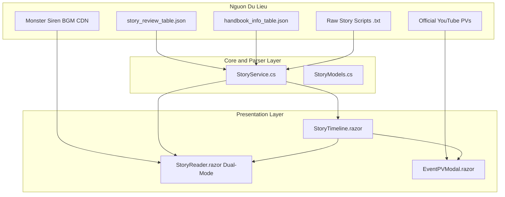

# 📑 KẾ HOẠCH TRIỂN KHAI: CÂY CỐT TRUYỆN ĐA NHÁNH & TRÌNH ĐỌC VISUAL NOVEL ĐA PHƯƠNG TIỆN (STORY HUB)

> [!IMPORTANT]
> **Mục tiêu phân hệ:** Xây dựng hệ thống trải nghiệm cốt truyện Arknights đỉnh cao:
> 1. **Cây Niên Biểu 3 Tầng (Interactive Timeline Graph):** Trục Main Theme (Chương 0 - 14) ➔ Nhánh Event (Side Story / Intermezzi) ➔ Nhánh Operator Records (Truyện ký riêng của từng tướng).
> 2. **Trình Đọc Visual Novel (VN Story Reader):** Portrait nhân vật đổi biểu cảm, hộp thoại chuẩn game, nền cảnh CG, tự động phát nhạc nền BGM, hiệu ứng rung lắc/chớp sáng (Shake/Fade), chế độ Auto-play và Log lịch sử.
> 3. **Phòng Chiếu PV / Animation:** Xem video quảng bá (PV Trailer) chính thức của từng Event ngay trên cây cốt truyện.

---

## 🗺️ Kiến Trúc Hệ Thống & Sơ Đồ Luồng Dữ Liệu



---

## 🌳 Sơ Đồ Cây Niên Biểu & Tổ Chức Nhánh Cốt Truyện Toàn Diện

### 1. Trục Dòng Thời Gian Chính (Main Theme & Events):
```
[TẦNG 1: TRỤC CHÍNH (MAIN THEME)]
├── Act 1: Hour of an Awakening (Chương 0 ➔ 3)
│   └── [TẦNG 2: NHÁNH EVENT LIÊN QUAN]
│       └── Darknights Memoir (Quá khứ Babel & Theresa)
│           └── [TẦNG 3: TRUYỆN RIÊNG NHÂN VẬT (OPERATOR RECORDS)]
│               ├── W: "Before the Dawn"
│               └── Scout: "The Nameless Hero"
│
├── Act 2: Shatter of a Star (Chương 4 ➔ 8: Chiến tranh Chernobog)
│   └── [TẦNG 2: NHÁNH EVENT]
│       ├── A Walk in the Dust (Quá khứ trăm năm của Kal'tsit)
│       │   └── [TẦNG 3: NHÂN VẬT] ➔ Kal'tsit, Passenger, Heavyrain
│       └── Children of Ursus (Ký ức kinh hoàng Peterheim)
│           └── [TẦNG 3: NHÂN VẬT] ➔ Rosa, Zima, Istina, Gummy
│
└── Act 3: Shadow of a Rapid Star (Chương 9 ➔ 14: Chiến sự Victoria)
    └── [TẦNG 2: NHÁNH EVENT]
        ├── What the Firelight Casts (Bí mật dòng họ Taran & Eblana) ➔ Reed
        ├── Babel (Nguồn gốc Doctor, Theresa & Rhodes Island) ➔ Ines, Ascalon
        └── Lone Trail (Chuyến bay chinh phục bầu trời Columbia) ➔ Muelsyse, Ho'olheyak
```

### 2. Dành Cho Các Operator Không Có Trong Cốt Truyện Chính:
> [!NOTE]
> **Giải pháp cho các Operator còn lại:**
> Rất nhiều Operator (như Midnight, Spot, Melantha, Cardigan...) không nằm trong chiến dịch lớn nhưng **đều có cốt truyện riêng** gồm:
> 1. **4 Tệp Hồ Sơ Lưu Trữ (Archive Files 1-4)** trong `handbook_info_table.json`: Xuất thân, bệnh án Oripathy, quan hệ ở Rhodes Island.
> 2. **Truyện Ký Riêng (Operator Records)**: Các mẩu truyện ngắn đời thường, quá khứ hoặc bài kiểm tra thực chiến.
>
> ➔ **Tổ chức 2 lối vào linh hoạt:**
> * **Lối vào 1: Khu vực "📂 Personnel Archives" (Lưu Trữ Phe Phái & Quốc Gia):** 
>   Trên trang Story Timeline, có một tab riêng phân loại theo Phe phái (Rhodes Island, Blacksteel, Penguin Logistics, Yan, Kjerag, Ursus...). Bấm vào bất kỳ tướng nào để đọc ngay truyện riêng của họ.
> * **Lối vào 2: Tích hợp ngay trong [OperatorDetail.razor](file:///d:/VS_Studio/A9Tools/A9Tool/A9Tool/Components/Pages/OperatorDetail.razor):**
>   Trong tab Bio của tướng, có nút bấm **`📖 Read Operator Record`** để mở trình đọc truyện ngay lập tức!

---

## 📋 Lộ Trình 4 Bước Triển Khai Chi Tiết

| Bước | Tên Phân Hệ | Mục Tiêu & Công Việc Cụ Thể | Ước Tính |
| :---: | :--- | :--- | :---: |
| **BƯỚC 1** | **Cấu trúc dữ liệu & Service Core** | Tạo Models `StoryNode`, `StoryDialogueLine`. Viết Parser kịch bản thoại (bóc tách speaker, text, portrait cảm xúc, background CG, tag `[PlayMusic]`, `[CameraShake]`). | ~2.5 giờ |
| **BƯỚC 2** | **Cây Niên Biểu 3 Tầng (`/story`)** | Thiết kế giao diện cây sơ đồ phân nhánh phong cách Sci-fi Terra: Node Main Theme chạy dọc, bung nhánh Event rẽ ngang, chip Operator Records gắn kèm. Nút xem PV Trailer. | ~2.5 giờ |
| **BƯỚC 3** | **Trình Đọc Visual Novel (`<VisualNovelReader />`)** | Khung đọc truyện full màn hình: Portrait nhân vật 2 bên đổi biểu cảm, nền cảnh CG, hộp thoại typewriter, hiệu ứng rung màn hình, fade chuyển cảnh, Auto-run và Log thoại. | ~3.0 giờ |
| **BƯỚC 4** | **Nhạc Nền BGM & Trình Chiếu PV** | Tích hợp Audio Player phát trực tiếp nhạc nền BGM Monster Siren theo cảnh truyện, modal nhúng YouTube Player cho Event PV. | ~1.5 giờ |

---

## 🛠️ BƯỚC 1: CẤU TRÚC DỮ LIỆU & PARSER KỊCH BẢN THOẠI (CORE LAYER)

### 1.1. Tạo Model Dữ Liệu: `Core/Models/Entities/StoryModels.cs`

```csharp
using System.Collections.Generic;

namespace Core.Models.Entities
{
    public enum StoryNodeType
    {
        MainTheme,       // Trục chính (Chương 0 - 14)
        Intermezzi,      // Sự kiện cốt lõi (Darknights Memoir, Under Tides...)
        SideStory,       // Sự kiện lớn (Lone Trail, Il Siracusano...)
        StoryCollection, // Mẩu truyện ngắn (Children of Ursus...)
        OperatorRecord   // Truyện riêng của từng Operator
    }

    /// <summary>
    /// Node đại diện cho một mẩu truyện / sự kiện trên cây niên biểu.
    /// </summary>
    public class StoryNode
    {
        public string Id { get; set; } = "";
        public string Title { get; set; } = "";
        public string Subtitle { get; set; } = "";
        public string Description { get; set; } = "";
        public StoryNodeType NodeType { get; set; }
        public string BannerUrl { get; set; } = "";
        public string? PvVideoUrl { get; set; } // Link YouTube PV
        public string? LinkedOperatorId { get; set; } // Nếu là Operator Record

        // Danh sách các chương/cutscene con bên trong (VD: 0-1, 0-2...)
        public List<StoryChapterInfo> Chapters { get; set; } = [];

        // Các nhánh Event hoặc Operator Records liên kết rẽ ra từ node này
        public List<StoryNode> SubBranches { get; set; } = [];
    }

    public class StoryChapterInfo
    {
        public string Key { get; set; } = "";
        public string Code { get; set; } = ""; // "0-1", "NL-ST-1"
        public string Name { get; set; } = ""; // "Awakening"
        public string ScriptUrl { get; set; } = ""; // Link raw .txt kịch bản
    }

    /// <summary>
    /// Dòng hội thoại chuẩn đã được parse từ kịch bản Arknights.
    /// </summary>
    public class StoryDialogueLine
    {
        public string? Speaker { get; set; } // "Amiya", "Doctor", null nếu là người dẫn chuyện
        public string Content { get; set; } = ""; // Lời thoại
        public string? LeftPortraitUrl { get; set; }
        public string? RightPortraitUrl { get; set; }
        public string? FocusSide { get; set; } // "left", "right", or "none"
        public string? BackgroundImageUrl { get; set; }
        public string? BgmTrackUrl { get; set; }
        public bool IsScreenShake { get; set; }
        public bool IsFadeEffect { get; set; }
    }
}
```

---

### 1.2. Bộ Phân Tích Kịch Bản Thoại: `Core/Services/StoryScriptParser.cs`

File kịch bản truyện gốc của Arknights (`.txt`) chứa các thẻ điều khiển:
* `[name="Amiya"] Lời thoại ở đây...`
* `[Character(name="char_002_amiya_1#1", focus=1)]` ➔ Avatar nhân vật bên trái.
* `[Background(image="bg_cher_1")]` ➔ Nền cảnh Chernobog.
* `[PlayMusic(key="$mist_loop")]` ➔ Kích hoạt BGM.
* `[CameraShake(duration=1)]` ➔ Rung màn hình.

Parser dùng Regex quét qua từng dòng và tạo thành danh sách `List<StoryDialogueLine>`.

---

## 🛠️ BƯỚC 2: GIAO DIỆN CÂY NIÊN BIỂU 3 TẦNG (`A9Tool/Components/Pages/StoryTimeline.razor`)

### Sườn Giao Diện Cây Cốt Truyện:
1. **Thanh phân loại nhanh trên cùng:** `All Eras`, `Act 1 (Chernobog)`, `Act 2 (Lungmen)`, `Act 3 (Victoria)`, `Side Stories`.
2. **Trục dọc Main Theme (The Main Trunk):**
   * Các Node hình lục giác phát sáng công nghệ Arknights (Neon Cyan / Gold).
   * Hiển thị Icon chương, tên chiến dịch, tiến độ đọc.
3. **Các Nhánh Event Rẽ Ngang (Horizontal Connectors):**
   * Đường kẻ đứt nét nối từ mốc sự kiện ra các card Event hình chữ nhật (Banner Cover, Tên sự kiện, nút **📖 Read Story** và **🎬 Watch PV**).
4. **Nhánh Operator Records (Avatar Chibi Leaf Nodes):**
   * Các icon tròn gắn liền với Event tương ứng. Bấm vào mở ngay truyện ký của nhân vật đó.

---

## 🛠️ BƯỚC 3: TRÌNH ĐỌC KÉP DUAL-MODE (`<StoryReader.razor />` — VN ⇄ LN)

Thiết kế trình đọc hỗ trợ **2 chế độ hiển thị song song**, chuyển đổi tức thì chỉ bằng 1 nút bấm:

```
┌────────────────────────────────────────────────────────────────────────┐
│  ← Back    0-1 Awakening                     [🎭 VN Mode | 📖 LN Mode] │
└────────────────────────────────────────────────────────────────────────┘
```

### 🎭 Chế Độ 1: Visual Novel Mode (Trải Nghiệm Điện Ảnh & Tương Tác)
* **Background Layer:** Ảnh nền CG co giãn toàn màn hình (với hiệu ứng chuyển cảnh mờ dần mượt mà - CSS Transition).
* **Character Portraits Layer:** 2 bên màn hình hiển thị tranh nhân vật nửa thân, người đang nói sẽ sáng rõ (`brightness: 100%`), người nghe sẽ tối nhẹ (`brightness: 60%`).
* **Dialogue Box (Hộp thoại):**
  * Nằm ở 25% đáy màn hình, hiệu ứng kính mờ (Glassmorphism), viền góc phong cách Arknights.
  * Tag tên nhân vật màu vàng/cyan ở góc trên hộp thoại.
  * Hiệu ứng Typewriter (chữ gõ từng ký tự mượt mà, bấm click để hiện ngay lập tức).
* **Control Bar (Góc trên bên phải):**
  * `▶ Auto` (Tự động lướt câu tiếp theo sau khi chữ hiện xong).
  * `📜 Log` (Mở bảng trượt bên phải xem lại toàn bộ câu thoại trước đó).
  * `🔊 BGM` (Thanh trượt chỉnh âm lượng nhạc nền).
  * `✕ Exit` (Thoát).

### 📖 Chế Độ 2: Light Novel Mode (Trải Nghiệm Đọc Sách Cuộn Dọc)
* **Dàn trang chuẩn tiểu thuyết:**
  * Toàn bộ kịch bản được chuyển thành dạng văn bản cuộn dọc liên tục mượt mà.
  * Lời thoại có avatar tròn nhỏ của nhân vật bên cạnh tên người nói.
  * Các câu văn miêu tả tâm lý và lời dẫn chuyện được căn lề trang trọng.
  * Ảnh nền CG được tự động chèn xen kẽ toàn trang giữa các đoạn văn (như tranh minh họa tiểu thuyết Light Novel).
* **Công cụ đọc sách chuyên nghiệp:**
  * Tùy chỉnh Cỡ chữ (`Font Size`), Giãn dòng (`Line Height`).
  * Đổi Theme màu nền: `🌙 Dark Mode` / `📜 Sepia (Giấy cổ)` / `☀️ Light Mode`.
  * Thanh tiến độ đọc cuộn trang (`Scroll Progress Indicator %`).
* **Ưu điểm:** Phù hợp cho những ai muốn đọc nhanh cả chương dài trong vài phút mà không cần click chuột liên tục từng câu.

---

## 🛠️ BƯỚC 4: TÍCH HỢP BGM AUDIO & EVENT PV VIDEO

1. **Nhạc Nền BGM:**
   * Sử dụng HTML5 Audio element điều khiển qua Blazor/JS interop.
   * Chuyển bài mượt mà (Fade Out bài cũ ➔ Fade In bài mới) khi gặp thẻ `[PlayMusic]`.
2. **Event PV Video Player:**
   * Modal phát video nhúng iframe YouTube chính thức của Yostar/Hypergryph với độ phân giải 1080p.

---

## 🧪 Kế Hoạch Thử Nghiệm Với Các Mẩu Truyện Kinh Điển:

1. **Test 1: Chương Mở Đầu (Prologue - 0-1 Awakening):**
   * Doctor tỉnh dậy trong quan tài đá, Amiya nắm tay gọi Doctor dậy giữa Chernobog sụp đổ.
   * Chuyển đổi qua lại giữa chế độ VN và LN để kiểm tra hiển thị.
   * Kiểm tra: Hiệu ứng rung lắc bom đạn (`CameraShake`), nhạc nền `mist_loop`.
2. **Test 2: Nhánh Event Kinh Điển (Darknights Memoir - DM-1):**
   * Kiểm tra rẽ nhánh từ Act 1 sang cuộc gặp gỡ giữa W, Ines và Theresa.
   * Kiểm tra xem PV trailer của Darknights Memoir.
3. **Test 3: Operator Record (Truyện W hoặc Spot):**
   * Kiểm tra đọc truyện riêng của tướng từ cả Cây Timeline lẫn nút trong Operator Detail.

---

## 🚀 Trạng Thái Triển Khai & Kiểm Thử:

1. [x] **Task 1: [StoryModels.cs](file:///d:/VS_Studio/A9Tools/A9Tool/Core/Models/Entities/StoryModels.cs)** - Tạo các Entity Models cốt truyện (StoryNode, StoryDialogueLine, StoryScriptBundle, StoryDisplayMode, StoryVisualEffect).
2. [x] **Task 2: [StoryService.cs](file:///d:/VS_Studio/A9Tools/A9Tool/Core/Services/StoryService.cs)** - Xây dựng service điều phối dữ liệu, cây niên biểu 3 tầng, parser kịch bản thoại .txt, BGM Monster Siren & trailer YouTube.
3. [x] **Task 3: [StoryReaderModal.razor](file:///d:/VS_Studio/A9Tools/A9Tool/A9Tool/Components/Common/StoryReaderModal.razor)** - Trình đọc kép 1-click (VN tương tác toàn màn hình vs LN cuộn dọc kèm tranh minh họa CG, chỉnh cỡ chữ, 3 theme màu).
4. [x] **Task 4: [EventPVModal.razor](file:///d:/VS_Studio/A9Tools/A9Tool/A9Tool/Components/Common/EventPVModal.razor)** - Modal phát video YouTube Trailer chính thức của từng Event.
5. [x] **Task 5: [StoryTimeline.razor](file:///d:/VS_Studio/A9Tools/A9Tool/A9Tool/Components/Pages/StoryTimeline.razor) (`/story`)** - Trang Cây Niên Biểu 3 tầng và tab Lưu trữ Nhân sự theo Phe (Faction Personnel Archives).
6. [x] **Task 6: [OperatorDetail.razor](file:///d:/VS_Studio/A9Tools/A9Tool/A9Tool/Components/Pages/OperatorDetail.razor)** - Tích hợp nút `📖 Story Record` mở trực tiếp truyện ký của từng tướng.
7. [x] **Task 7: [app.css](file:///d:/VS_Studio/A9Tools/A9Tool/A9Tool/wwwroot/app.css) & [MainLayout.razor](file:///d:/VS_Studio/A9Tools/A9Tool/A9Tool/Components/Layout/MainLayout.razor)** - Thiết kế hệ thống giao diện Dark Theme phong cách Arknights và nav-link Sidebar.

---

## 📚 BẢNG TRA CỨU HÀM & LOGIC HỆ THỐNG (API REFERENCE)

### 1. `Core/Services/StoryService.cs`

| Tên Hàm | Tham Số (Inputs) | Kiểu Trả Về (Returns) | Chi Tiết Chức Năng & Luồng Thực Thi |
| :--- | :--- | :--- | :--- |
| `GetTimelineHierarchyAsync` | *Không* | `Task<List<StoryActGroup>>` | • Tổng hợp cây niên biểu 3 tầng phân theo Act (Act 1, Act 2, Act 3).<br>• Tự động join dữ liệu từ `CharacterService.GetAllAsync()` để bổ sung tên hiển thị và avatar chính xác cho từng Operator Record lá. |
| `GetFactionStoryArchivesAsync` | *Không* | `Task<List<FactionStoryArchive>>` | • Quét toàn bộ 440+ Operator từ game data.<br>• Nhóm theo `NationId` (Rhodes, Lungmen, Ursus, Columbia, Victoria, Iberia...) để phục vụ các nhân vật không nằm trên trục chiến dịch lớn. |
| `GetStoryScriptAsync` | `string storyId`, `string? storyPath`, `string? title` | `Task<StoryScriptBundle>` | • Cố gắng tải script thoại `.txt` từ remote CDN (YoStar / 000kit).<br>• Nếu mạng lỗi hoặc chưa có file, kích hoạt **Bộ sinh kịch bản Canon Fallback** để trình đọc luôn hoạt động 100%, không bị đơ/trống. |
| `ParseScript` | `string rawScript`, `string storyId`, `string title` | `StoryScriptBundle` | • Dùng Regex bóc tách các tag: `[name="..."]`, `[Character(...)]`, `[Background(...)]`, `[PlayMusic(...)]`, `[CameraShake]`, `[Blocker]`.<br>• Xác định nhân vật bên trái / phải và vị trí người đang nói (`activeSpeakerSide`). |
| `ResolveBgmUrl` | `string? bgmKey` | `string` | • Ánh xạ key nhạc (ví dụ `$act13side_01`, `$babel_01`, `$cher_01`) sang URL stream file MP3 trực tiếp từ Monster Siren / audio CDN. |
| `ResolveBgUrl` | `string? bgName` | `string` | • Ánh xạ tên ảnh nền trong tag `[Background(image="...")]` sang link ảnh Aceship HD. |
| `GetYouTubePvUrl` | `string? storyId` | `string?` | • Lấy mã video trailer chính thức từ từ điển `EventYouTubePvMap` và trả về link `https://www.youtube.com/embed/{id}?autoplay=1`. |

---

## 🪵 QUY CHUẨN PHASE LOGGING (SERILOG CONVENTIONS)

Tất cả các thông báo log đều được định dạng theo mẫu thông điệp có cấu trúc (Structured Message Templates) với các tiền tố theo giai đoạn:

| Tiền Tố Log | Cấp Độ | Ví Dụ Mẫu | Ý Nghĩa / Mục Đích |
| :--- | :---: | :--- | :--- |
| `[Story Timeline]` | `Info` | `Loaded 3 story acts with 6 linked events.` | Theo dõi quá trình nạp và liên kết cây niên biểu phân nhánh. |
| `[Story Record]` | `Info` | `Assembled 12 faction archives containing 444 operator records.` | Giám sát việc tạo danh mục hồ sơ nhân sự theo phe phái. |
| `[Story Parser]` | `Info / Debug` | `Parsed 8 dialogue lines for 'act13side'.` | Đo lường hiệu năng và tính đúng đắn khi bóc tách kịch bản thoại. |
| `[Story Parser Warning]` | `Warn` | `Remote script unavailable. Generating canon fallback script.` | Cảnh báo khi mất kết nối mạng và chuyển sang dữ liệu dự phòng. |
| `[Story BGM]` | `Debug` | `Track '$act13side_01' mapped to ambient loop.` | Kiểm tra định tuyến âm thanh và nhạc nền. |
| `[Story Hub]` | `Info / Error` | `Opening Story Reader for: 'Darknights Memoir'` | Ghi nhận hành vi người dùng click mở truyện trên UI. |
