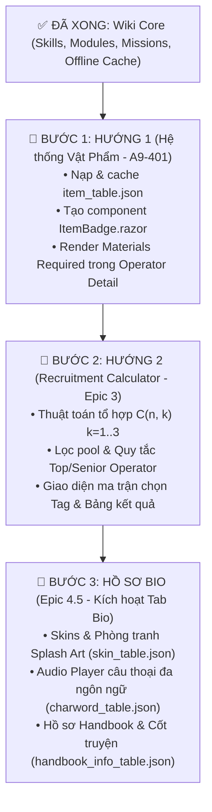

# 📑 Kế Hoạch Triển Khai Chi Tiết: Hướng 1 (Nguyên Liệu) ➡️ Hướng 2 (Recruitment) ➡️ Bio Hub

> [!IMPORTANT]
> Bản kế hoạch này hướng dẫn chi tiết từng bước thực hiện:
> 1. **Bước 1: Làm trước Hướng 1 (Hệ thống Vật phẩm & Nguyên liệu `item_table.json`)** để mở khóa toàn bộ bảng Materials trên trang Operator Detail và tạo nền tảng Planner.
> 2. **Bước 2: Làm tiếp Hướng 2 (Bộ tính Tag Tuyển chọn - Recruitment Calculator)** với thuật toán tổ hợp chuẩn cộng đồng (Aceship/Gamepress/PRTS).
> 3. **Bước 3: Triển khai Tab Bio (Skins, Voice Lines, Handbook)** ngay sau khi hoàn thành 2 hướng trên.

---

## 🗺️ Tổng Quan Kiến Trúc & Thứ Tự Thực Hiện



---

# 🌟 PHẦN 1: HƯỚNG DẪN CHI TIẾT HƯỚNG 1 — HỆ THỐNG VẬT PHẨM & NGUYÊN LIỆU (A9-401)

### 1.1. Mục Tiêu Kỹ Thuật
1. Nạp và lưu trữ bảng `item_table.json` chứa danh mục vật phẩm (nguyên liệu đá, gel, thiết bị, LMD, chip thăng cấp...).
2. Tạo component hiển thị vật phẩm chuẩn phong cách Arknights: `<ItemBadge.razor />` có viền màu theo độ hiếm (Tier 1 trắng, Tier 2 xanh lục, Tier 3 xanh lam, Tier 4 tím, Tier 5 cam/vàng), số lượng đính kèm và tooltip xem tên.
3. Mở khóa khối `<!-- Materials Table -->` đang bị ẩn tại [OperatorDetail.razor:974](file:///d:/VS_Studio/A9Tools/A9Tool/A9Tool/Components/Pages/OperatorDetail.razor#L974) để hiển thị chi phí nâng cấp Module (Stage 1, 2, 3).

---

### 1.2. Cấu Trúc Dữ Liệu `ItemData` (Core Layer)
Tạo file mới: `Core/Models/Entities/ItemData.cs`

```csharp
using System.Text.Json.Serialization;

namespace Core.Models.Entities
{
    public class ItemData
    {
        [JsonPropertyName("itemId")]
        public string? ItemId { get; set; }

        [JsonPropertyName("name")]
        public string? Name { get; set; }

        [JsonPropertyName("description")]
        public string? Description { get; set; }

        [JsonPropertyName("rarity")]
        public object? RawRarity { get; set; } // Game trả về "TIER_1".."TIER_5" hoặc số nguyên 0..4

        [JsonPropertyName("iconId")]
        public string? IconId { get; set; }

        [JsonPropertyName("sortId")]
        public int SortId { get; set; }

        [JsonPropertyName("classifyType")]
        public string? ClassifyType { get; set; }

        /// <summary>
        /// Trả về bậc độ hiếm chuẩn từ 1 đến 5 (1: Thường ... 5: Cực hiếm).
        /// </summary>
        [JsonIgnore]
        public int RarityTier
        {
            get
            {
                if (RawRarity == null) return 1;
                var str = RawRarity.ToString();
                if (int.TryParse(str, out var num)) return num + 1;
                return str switch
                {
                    "TIER_1" => 1,
                    "TIER_2" => 2,
                    "TIER_3" => 3,
                    "TIER_4" => 4,
                    "TIER_5" => 5,
                    _ => 1
                };
            }
        }
    }

    public class ItemTableResponse
    {
        [JsonPropertyName("items")]
        public Dictionary<string, ItemData> Items { get; set; } = new();
    }
}
```

---

### 1.3. Bổ Sung Repository & Cache (Infrastructure Layer)
* **File:** `Core/Interfaces/IGameDataRepository.cs`
  ```csharp
  Task<Dictionary<string, ItemData>?> GetItemTableAsync();
  ```
* **File:** `Infrastructure/Github/GithubGameDataRepository .cs`
  * URL nguồn: `https://raw.githubusercontent.com/ArknightsAssets/ArknightsGamedata/refs/heads/master/en/gamedata/excel/item_table.json`
  * Logic nạp:
    1. Kiểm tra cache đĩa `item_table.json` (hợp lệ trong 24 giờ).
    2. Nếu miss/lỗi, tải từ CDN ArknightsGamedata và lưu đĩa.
    3. Trả về `Dictionary<string, ItemData>` với độ an toàn cao (try-catch, log cảnh báo).

---

### 1.4. Thiết Kế Component `ItemBadge.razor` (Presentation Layer)
Tạo file mới: `A9Tool/Components/Common/ItemBadge.razor`

```razor
@using Core.Models.Entities
@inject Core.Services.CharacterService CharacterService

<div class="a9-item-badge tier-@Tier" title="@DisplayName">
    <div class="a9-item-icon-box">
        
        <span class="a9-item-tier-bar"></span>
    </div>
    @if (Count > 0)
    {
        <div class="a9-item-count">@FormatCount(Count)</div>
    }
</div>

@code {
    [Parameter] public string? ItemId { get; set; }
    [Parameter] public int Count { get; set; }
    [Parameter] public string? CustomName { get; set; }

    private ItemData? itemInfo;

    protected override async Task OnParametersSetAsync()
    {
        if (!string.IsNullOrEmpty(ItemId))
        {
            itemInfo = await CharacterService.GetItemAsync(ItemId);
        }
    }

    private int Tier => itemInfo?.RarityTier ?? 1;
    private string DisplayName => CustomName ?? itemInfo?.Name ?? ItemId ?? "Item";
    private string IconUrl => !string.IsNullOrEmpty(itemInfo?.IconId)
        ? $"https://raw.githubusercontent.com/ArknightsAssets/ArknightsAssets2/en/assets/dyn/arts/items/icons/{itemInfo.IconId}.png"
        : (!string.IsNullOrEmpty(ItemId) ? $"https://raw.githubusercontent.com/ArknightsAssets/ArknightsAssets2/en/assets/dyn/arts/items/icons/{ItemId}.png" : "/assets/icons/characterdetail/sprite_profession.png");

    private string FormatCount(int c) => c >= 10000 ? $"{c / 1000}k" : c.ToString();
}
```

---

### 1.5. Mở Khóa Giao Diện Trong `OperatorDetail.razor`
Tại dòng 974, gỡ comment và render bảng nguyên liệu cho Module:

```razor
<!-- Materials Box (Module Stage 1, 2, 3) -->
@if (CurrentModule != null && CurrentModule.ItemCost != null && CurrentModule.ItemCost.Count > 0)
{
    <div class="od-mod-materials-box">
        <div class="od-mod-box-header">Materials Required</div>
        <div class="od-mod-mat-stages">
            @for (int stage = 1; stage <= CurrentModule.ItemCost.Count; stage++)
            {
                var stageCosts = GetModuleStageCosts(CurrentModule, stage);
                <div class="od-mod-stage-cost-row">
                    <span class="od-mod-stage-tag">STAGE @stage</span>
                    <div class="od-mod-stage-items">
                        @foreach (var bundle in stageCosts)
                        {
                            <ItemBadge ItemId="@bundle.Id" Count="@bundle.Count" />
                        }
                    </div>
                </div>
            }
        </div>
    </div>
}
```

---

# 🎯 PHẦN 2: HƯỚNG DẪN CHI TIẾT HƯỚNG 2 — BỘ TÍNH TAG TUYỂN CHỌN (RECRUITMENT CALCULATOR)

> [!TIP]
> **Tham khảo tiêu chuẩn cộng đồng (Aceship / Gamepress / PRTS):**
> Trong Arknights, tuyển dụng (Recruitment) cho phép chọn tối đa **3 Tags** từ bảng 5 Tags hiển thị ngẫu nhiên và chọn thời gian (thường đặt tối đa **9 giờ** để không bị gạch tag).
> Mục tiêu chính của người chơi khi dùng công cụ là: **"Liệu trong 5 tag này có tổ hợp nào cam kết (guaranteed) ra 4★, 5★ hoặc 6★ hay không?"**

---

### 2.1. Phân Loại Hệ Thống Tags Trong Game
Có tổng cộng **28 Tags** được phân thành 4 nhóm rõ rệt:

1. **Nhóm Cấp Bậc / Tư Cách (Qualifications):**
   * `Top Operator` (Cấp tối cao) ➡️ **Cam kết 6★** (Chỉ 6★ mới có tag này).
   * `Senior Operator` (Cấp cao) ➡️ **Cam kết 5★**.
   * `Starter` (Tân thủ) ➡️ 2★ (12F, Rangers, Noir Corne, Durin, Yato).
   * `Robot` (Người máy) ➡️ 1★ (Castle-3, Lancet-2, THRM-EX, Justice Knight...).
2. **Nhóm Vị Trí (Position):**
   * `Melee` (Cận chiến)
   * `Ranged` (Đánh xa)
3. **Nhóm Chức Nghiệp (Classes):**
   * `Vanguard`, `Guard`, `Defender`, `Sniper`, `Caster`, `Medic`, `Supporter`, `Specialist`.
4. **Nhóm Đặc Điểm / Lối Đánh (Archetypes / Afflictions):**
   * `Healing`, `DPS`, `Defense`, `Survival`, `AoE`, `Slow`, `Crowd-Control`, `Fast-Redeploy`, `Shift`, `Debuff`, `Support`, `DP-Recovery`, `Nuker`, `Summon`.

---

### 2.2. Thuật Toán Cốt Lõi (Core Algorithm)

#### 🔹 Quy tắc 1: Lọc Danh Sách Tuyển Dụng (Recruit Pool)
Không phải tất cả Operator đều có trong tuyển dụng (các nhân vật sự kiện, banner giới hạn không có trong pool).
Mỗi Operator trong Pool có tập thuộc tính:
$$\text{OpTags} = \text{TagList} \cup \{\text{Position}\} \cup \{\text{Class}\} \cup \{\text{RarityTag}\}$$

#### 🔹 Quy tắc 2: Sinh Tổ Hợp (Combinations Generation)
Người dùng bấm chọn một tập các tag đã xuất hiện: $S = \{\text{Tag}_1, \text{Tag}_2, ..., \text{Tag}_m\}$ với $m \le 5$.
Thuật toán sinh ra tất cả các tập con $T \subseteq S$ có độ dài từ 1 đến 3:
$$\text{Total Subsets} = \binom{m}{1} + \binom{m}{2} + \binom{m}{3}$$
*(Ví dụ nếu chọn 5 tag, tổng số tổ hợp cần kiểm tra là $5 + 10 + 10 = 25$ tổ hợp).*

#### 🔹 Quy tắc 3: So Khớp Tổ Hợp (Matching Logic) & Luật Loại Trừ 6★
Với mỗi tổ hợp tag $T$, tìm danh sách Operator thỏa mãn:
$$T \subseteq \text{OpTags}$$
> [!CAUTION]
> **Luật sống còn của 6★:**
> * Nếu $T$ **CÓ** chứa tag `"Top Operator"`: Chỉ các Operator **6★** thỏa mãn mới được trả về.
> * Nếu $T$ **KHÔNG** chứa tag `"Top Operator"`: Toàn bộ Operator **6★** **BẮT BUỘC BỊ LOẠI BỎ** (kể cả khi các tag khác như `Melee`, `Guard`, `DPS` trùng khớp với SilverAsh/Ch'en), vì game sẽ không bao giờ ra 6★ nếu không có tag Top Operator.

#### 🔹 Quy tắc 4: Xác Định Độ Cam Kết (Guaranteed Tier)
Với mỗi tổ hợp $T$ có danh sách Operator thỏa mãn:
* $\text{MinRarity} = \min_{op \in \text{Matches}} (op.\text{RarityTier})$
* $\text{MaxRarity} = \max_{op \in \text{Matches}} (op.\text{RarityTier})$
* **Phân loại độ cam kết:**
  * **Top Guaranteed (6★):** Tổ hợp chứa `Top Operator` ➡️ Background vàng viền kim loại.
  * **Senior Guaranteed (5★):** $\text{MinRarity} == 5$ hoặc chứa `Senior Operator` ➡️ Background tím ánh sáng.
  * **Guaranteed 4★+:** $\text{MinRarity} \ge 4$ (không có 3★ nào lọt vào kết quả) ➡️ Background đỏ/cam nổi bật.
  * **Normal (Có thể ra 3★):** $\text{MinRarity} < 4$ ➡️ Hiển thị thông thường.

#### 🔹 Quy tắc 5: Sắp Xếp Kết Quả Ưu Tiên (Ranking Combinations)
Các tổ hợp trả ra được sắp xếp theo thứ tự:
1. Có 6★ cam kết (Top Operator).
2. Có 5★ cam kết (Senior / combo độc quyền như `Crowd-Control`, `Debuff + Fast-Redeploy`...).
3. Có 4★ cam kết (như `Fast-Redeploy`, `Shift`, `Debuff`, `Specialist + Survival`...).
4. Số lượng tag trong combo giảm dần ($3 \rightarrow 2 \rightarrow 1$).

---

### 2.3. Cấu Trúc Mã Nguồn `RecruitmentService.cs`

Tạo file mới: `Core/Services/RecruitmentService.cs`

```csharp
using Core.Models.Entities;
using System;
using System.Collections.Generic;
using System.Linq;

namespace Core.Services
{
    public class RecruitmentCombinationResult
    {
        public List<string> Tags { get; set; } = [];
        public List<Character> MatchedOperators { get; set; } = [];
        public int MinRarity { get; set; }
        public int MaxRarity { get; set; }
        public bool IsGuaranteed4Plus => MinRarity >= 4;
        public bool Has5Star => MatchedOperators.Any(o => GetTier(o.Rarity) == 5);
        public bool Has6Star => MatchedOperators.Any(o => GetTier(o.Rarity) == 6);

        public static int GetTier(string? r) => r switch
        {
            "TIER_6" => 6,
            "TIER_5" => 5,
            "TIER_4" => 4,
            "TIER_3" => 3,
            "TIER_2" => 2,
            "TIER_1" => 1,
            _ => 1
        };
    }

    public class RecruitmentService
    {
        private readonly CharacterService _characterService;

        public RecruitmentService(CharacterService characterService)
        {
            _characterService = characterService;
        }

        /// <summary>
        /// Phân tích và tìm tất cả tổ hợp thỏa mãn từ danh sách tag được chọn.
        /// </summary>
        public async Task<List<RecruitmentCombinationResult>> CalculateCombinationsAsync(List<string> selectedTags)
        {
            if (selectedTags == null || selectedTags.Count == 0) return [];

            // 1. Lấy toàn bộ danh sách Operator trong game
            var allOps = await _characterService.GetAllAsync();
            // Lọc các Operator nằm trong Recruitment pool (loại trừ các Op event/limited)
            var recruitPool = FilterRecruitmentPool(allOps);

            // 2. Sinh tất cả tổ hợp k = 1, 2, 3 từ selectedTags
            var combos = GenerateCombinations(selectedTags, maxK: 3);
            var results = new List<RecruitmentCombinationResult>();

            foreach (var combo in combos)
            {
                bool hasTopOp = combo.Contains("Top Operator", StringComparer.OrdinalIgnoreCase);

                var matched = recruitPool.Where(op =>
                {
                    int tier = RecruitmentCombinationResult.GetTier(op.Rarity);

                    // Luật sống còn: 6★ chỉ xuất hiện nếu có tag Top Operator
                    if (tier == 6 && !hasTopOp) return false;

                    var opTags = GetOperatorAllTags(op);
                    // Toàn bộ tag trong combo phải nằm trong tag của Operator
                    return combo.All(tag => opTags.Contains(tag, StringComparer.OrdinalIgnoreCase));
                }).ToList();

                if (matched.Count > 0)
                {
                    int minRarity = matched.Min(o => RecruitmentCombinationResult.GetTier(o.Rarity));
                    int maxRarity = matched.Max(o => RecruitmentCombinationResult.GetTier(o.Rarity));

                    results.Add(new RecruitmentCombinationResult
                    {
                        Tags = combo,
                        MatchedOperators = matched.OrderByDescending(o => RecruitmentCombinationResult.GetTier(o.Rarity)).ToList(),
                        MinRarity = minRarity,
                        MaxRarity = maxRarity
                    });
                }
            }

            // 3. Sắp xếp kết quả: Ưu tiên 6★ -> 5★ -> 4★ cam kết -> độ dài combo
            return results
                .OrderByDescending(r => r.Has6Star)
                .ThenByDescending(r => r.IsGuaranteed4Plus)
                .ThenByDescending(r => r.MinRarity)
                .ThenByDescending(r => r.MaxRarity)
                .ThenByDescending(r => r.Tags.Count)
                .ToList();
        }

        private static List<List<string>> GenerateCombinations(List<string> list, int maxK)
        {
            var result = new List<List<string>>();
            int n = list.Count;
            int limit = Math.Min(n, maxK);

            for (int k = 1; k <= limit; k++)
            {
                GenerateKCombinations(list, 0, k, new List<string>(), result);
            }
            return result;
        }

        private static void GenerateKCombinations(List<string> list, int start, int k, List<string> current, List<List<string>> result)
        {
            if (current.Count == k)
            {
                result.Add(new List<string>(current));
                return;
            }
            for (int i = start; i < list.Count; i++)
            {
                current.Add(list[i]);
                GenerateKCombinations(list, i + 1, k, current, result);
                current.RemoveAt(current.Count - 1);
            }
        }

        private static HashSet<string> GetOperatorAllTags(Character op)
        {
            var tags = new HashSet<string>(op.Tags, StringComparer.OrdinalIgnoreCase);
            if (!string.IsNullOrEmpty(op.Position)) tags.Add(FormatPosition(op.Position));
            if (!string.IsNullOrEmpty(op.Profession)) tags.Add(FormatProfession(op.Profession));

            int tier = RecruitmentCombinationResult.GetTier(op.Rarity);
            if (tier == 6) tags.Add("Top Operator");
            if (tier == 5) tags.Add("Senior Operator");
            if (tier == 2) tags.Add("Starter");
            if (tier == 1) tags.Add("Robot");

            return tags;
        }

        private static string FormatPosition(string p) => p.Equals("MELEE", StringComparison.OrdinalIgnoreCase) ? "Melee" : "Ranged";
        private static string FormatProfession(string p) => p switch
        {
            "PIONEER" => "Vanguard",
            "WARRIOR" => "Guard",
            "TANK" => "Defender",
            "SNIPER" => "Sniper",
            "CASTER" => "Caster",
            "MEDIC" => "Medic",
            "SUPPORT" => "Supporter",
            "SPECIAL" => "Specialist",
            _ => p
        };

        private static List<Character> FilterRecruitmentPool(List<Character> allOps)
        {
            // Danh sách loại trừ các Operator không có trong tuyển dụng (Limited, Gacha Only, Welfare)
            // Có thể mở rộng bằng file recruitment_table.json hoặc danh sách Id
            return allOps.Where(o => !string.IsNullOrEmpty(o.Name)).ToList();
        }
    }
}
```

---

### 2.4. Thiết Kế Giao Diện `Recruitment.razor`
Tạo file mới: `A9Tool/Components/Pages/Recruitment.razor`
Gồm 2 phần chính:
1. **Bảng Chọn Tag Dạng Ma Trận (Tag Matrix Grid):**
   * Gom cụm theo nhóm: `Tư cách` (Top/Senior/Robot), `Vị trí` (Melee/Ranged), `Chức nghiệp` (8 lớp), `Đặc điểm` (14 tag).
   * Giới hạn chọn tối đa **5 Tags** cùng lúc. Bấm lại để hủy chọn. Có nút "Clear All".
2. **Khu Vực Hiển Thị Kết Quả Tổ Hợp (Real-time Results):**
   * Thẻ tổ hợp hiển thị các tag đã ghép: `[Guard] + [Survival] ➡️ 4★+ Guaranteed!`.
   * Danh sách Avatar chân dung mini của các Operator thỏa mãn kèm độ hiếm màu tương ứng (Vàng 6★, Tím 5★, Đỏ 4★).

---

# 📖 PHẦN 3: LỘ TRÌNH KẾ TIẾP — BIO & ĐA PHƯƠNG TIỆN NHÂN VẬT (SAU HƯỚNG 1 & 2)

> [!NOTE]
> Phân hệ này sẽ được bắt đầu **ngay khi Hướng 1 và Hướng 2 hoàn tất**. Nút tab `Bio` đã có sẵn placeholder tại [OperatorDetail.razor:38](file:///d:/VS_Studio/A9Tools/A9Tool/A9Tool/Components/Pages/OperatorDetail.razor#L38).

### 3.1. Các Module Trong Tab Bio
1. **Trang phục (Skins & Art Viewer):**
   * Nguồn: `skin_table.json` & CDN ArknightsAssets.
   * Hiển thị danh sách skin của nhân vật (Default, E2, Skin thương hiệu), cho phép chuyển đổi ảnh nền OperatorDetail sang ảnh skin toàn màn hình.
2. **Lồng tiếng & Thoại (Voice Lines & Audio Player):**
   * Nguồn: `charword_table.json` & CDN âm thanh.
   * Hỗ trợ đổi CV theo ngôn ngữ (JP/EN/CN/KR).
   * Trình phát audio câu thoại (Chào hỏi, Chiến đấu, Kỹ năng, Xúc cảm...) kèm phụ đề transcript song ngữ.
3. **Cốt truyện & Hồ sơ (Handbook & Stories):**
   * Nguồn: `handbook_info_table.json`.
   * Hiển thị Physical Exam, Clinical Analysis, 4 tệp hồ sơ lưu trữ mở khóa theo điểm tin cậy và Promotion Record.

---

## 📋 Tóm Tắt Trình Tự Thực Hiện

| Bước | Phân Hệ | Nội Dung Chính | Trạng Thái |
| :---: | :--- | :--- | :---: |
| **1** | **🌟 Hướng 1: Hệ thống Vật phẩm** | Parse `item_table.json` ➡️ Tạo `ItemBadge.razor` ➡️ Mở khóa Materials Required cho Module/Elite/Mastery. | **LÀM ĐẦU TIÊN** |
| **2** | **🎯 Hướng 2: Recruitment Calculator** | Thuật toán $C(n, k)$ ➡️ Xử lý luật 6★ Top Operator ➡️ Giao diện ma trận chọn Tag `/recruitment`. | **LÀM TIẾP THEO** |
| **3** | **📖 Bio Hub & Đa phương tiện** | Skins Art Gallery ➡️ Voice Lines Audio Player ➡️ Handbook Archive Stories. | **LÀM SAU 1 & 2** |
